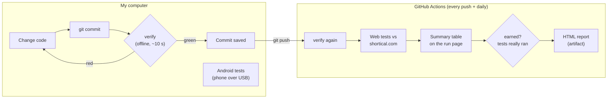
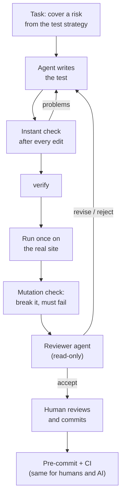

# Shortical QA starter

A first cut of the test automation I would build as Shortical's first QA
engineer: automated checks for the web client and the Android app, a test
strategy, two bugs found on the live site, and a setup that lets an AI agent
write tests without being trusted blindly.

Everything runs against **production, read-only**: no sign-in, nothing typed
into the paywall, no purchases.

**Status today**

| Part | State |
|---|---|
| Web tests (Playwright) | ✅ 20 runs (10 tests × phone and desktop) against shortical.com on every push and every morning in GitHub Actions |
| Code quality gate | ✅ Runs before every commit and in CI |
| Android tests (Appium) | 🟡 Written and type-checked; not yet run on a device (locators still need to be taken from the real app) |
| iOS | ⏸ Needs the team's iOS build ([why](#ios)) |
| Bugs found | 2 on the live site, see [FINDINGS](docs/FINDINGS.md) |

---

## How it works, in plain words

### Where things run



| Where | When | What runs |
|---|---|---|
| My computer, automatically | every `git commit` | `verify`: checks the test code itself. If it is red, the commit is refused. No site, no phone needed. |
| GitHub Actions | every push, every pull request, every morning | `verify` again, then the web tests against the live site, a results table on the run page, and a check that the green result was earned. |
| My computer, by hand | when needed | Android tests on a real phone with Shortical from the Play Store. Not in CI: there is no app build a CI machine may install. |

### What is checked

**1. The test code itself (`npm run verify`).** Before any test touches the
product, the code that tests it is checked:

- no type errors, no forgotten `await` (the most common way a UI test passes
  while checking nothing);
- seven project rules: no "just wait 5 seconds", no selectors inside tests,
  no `.only` left behind, known bugs must point to a written finding, and
  **no test may write anything on production**;
- the rule checker is itself tested: it must catch 20 deliberately planted
  mistakes, otherwise a clean result would mean nothing;
- every test compiles and the Android configuration is valid.

**2. The live website (web tests).**

- The catalogue is there, and the episode list matches the count the page claims.
- Video **really plays**: playback time moves forward, the video stream (HLS)
  loads without errors, and the next episode is fetched in advance so it starts instantly.
- The paywall boundary: the last free episode plays with no gate; the first
  paid one shows the sign-in gate and **no video for it is downloaded at all**.
- Two known bugs are pinned: the tests are marked "expected to fail", so the
  suite stays green while the bugs exist and turns red the day they are fixed.

**3. The Android app (Android tests, run on a phone).** Cold start to playing
video, swipe to the next episode, coming back from the background, and the same
paywall boundary. Because a native player exposes no playback time, "is the
video playing" is checked by comparing screenshots a moment apart.

**4. Was the green result earned?** A run where nothing executed, or where
tests were silently skipped, also ends "green". After every CI run a separate
step reads the report and calls it **PASS**, **FAIL** or **NOT-EARNED**.

### Where AI fits in

**There is no AI inside the checks.** Tests, `verify` and CI are ordinary code
that gives the same answer every time. A pass or fail never depends on what a
model decided.

AI is used where tests are **written and changed**. An agent is fast at that,
but it is rewarded for making checks pass, and "pass" can be reached by
weakening the check instead of doing the work. So this repo assumes the agent
will sometimes take a shortcut, and makes shortcuts either impossible or
visible:



What each step is for:

1. **Clear instructions.** [AGENTS.md](AGENTS.md) tells any agent what the
   repo is, which commands to run, what it must never do, and what "done"
   means. Step-by-step guides for common jobs (write a web test, write an
   Android test, investigate a failure) live in [`.claude/skills/`](.claude/skills).
2. **Instant feedback.** After every file the agent edits, the project rules
   and the linter run on that file and the errors go straight back to it,
   instead of piling up until the end.
3. **No way around the checks.** The agent's commands are screened: skipping
   the pre-commit check, hiding a failure with `|| true`, or force-pushing is
   blocked. Changing the rules themselves needs a human's approval.
4. **Proof the test can fail.** `npm run mutate` deliberately breaks the
   behaviour under test (for example, looks for the paywall one episode too
   early) and requires the test to go red. A test that stays green when the
   product is broken is not a test.
5. **Zero is not green.** A check like "no video was downloaded" also passes
   when the measurement is broken. Every such check first proves, in the same
   test, that the measurement can see something.
6. **A second opinion.** A separate reviewer agent, on a different model and
   with read-only access, first writes down what a good test for this risk
   must prove, only then reads the code, and answers ACCEPT, REVISE or REJECT.
7. **A human decides.** The agent never pushes. The person reviews the change
   and commits it, and the same pre-commit check and CI apply to people and
   agents alike.

### What this has caught so far

- **Two bugs on the live site** ([FINDINGS](docs/FINDINGS.md)): the episode
  count differs between pages, and paid episodes are titled "Watch Free".
- **A product change:** a week after the tests were written, the paywall
  gate's text changed from "Save your progress" to "Sign in". CI went red on
  the next run, the behaviour was confirmed unchanged, the test was updated.
  (It is also the best argument for adding test ids to the app.)
- **Four weak spots in this repo's own tests**, found by applying the rules
  to it: two tests with selectors in the wrong place, and two "nothing
  happened" checks that could have passed without measuring anything.
- **A test that kept running out of time on CI**, flagged as flaky by the
  report instead of being hidden by the retry.

### Not exercised yet

The agent hooks were tested by feeding them sample commands and edits, and the
rule checker against planted mistakes; the reviewer agent has not yet been
calibrated on planted defects, and the Android tests have not run on a phone.

---

## Reference

### Documents

- [docs/HOW_TESTS_WORK.md](docs/HOW_TESTS_WORK.md): project structure, how a run works, what each test checks and why
- [docs/TEST_STRATEGY.md](docs/TEST_STRATEGY.md): risks, levels, release criteria, what I would ask for in week one
- [docs/FINDINGS.md](docs/FINDINGS.md): bugs and testability notes, each bug pinned by a test
- [AGENTS.md](AGENTS.md): rules and definition of done for AI agents working in the repo

### What is covered

| Area | Web (Playwright) | Android (Appium) |
|---|---|---|
| Catalogue: home lists dramas, series page episode grid matches its count, free range stated | ✓ | |
| Playback actually progresses (not just "player is visible") | ✓ position advances | ✓ picture keeps changing |
| HLS: manifests and segments load from the CDN with no errors | ✓ | |
| Next episode preloaded during playback | ✓ | |
| Swipe to next episode | | ✓ |
| Cold start to playing video (time logged) | | ✓ |
| Background and resume | | ✓ |
| Paywall: last free episode plays, first locked one is gated and streams nothing | ✓ | ✓ |
| Episode count consistent across surfaces (known bug, `test.fail`) | ✓ | |
| Locked episode page doesn't promise "Watch Free" (known bug, `test.fail`) | ✓ | |

Web: 10 tests × 2 projects (Pixel 7 emulation and desktop Chrome). Android: 6 tests.

### Run the web suite

```bash
npm ci
npm run verify                  # offline checks, ~10-30 s, same as the pre-commit hook
npx playwright install chrome   # branded Chrome: episodes are H.264, bundled Chromium has no H.264
npm run test:web
npm run earned                  # PASS / FAIL / NOT-EARNED for the run
npm run test:web:report         # HTML report, traces and videos for failures
```

Another series: `SHORTICAL_DRAMA=keys-to-my-heart-25 npm run test:web`. The free
range and episode counts are read from the site, not hard-coded.

### Run the Android suite

Prerequisites: Node 20+, JDK 17+ (Android Studio's bundled `jbr` works), the
Android SDK with platform-tools and build-tools, `ANDROID_HOME` and `JAVA_HOME`
set, and a phone with **Shortical installed from the Play Store** (package
`shortical.com`) connected with USB debugging on.

```bash
npm ci                                    # also installs the UiAutomator2 driver (pinned dev dependency)
npx appium driver doctor uiautomator2     # checks ANDROID_HOME, JAVA_HOME, adb
adb devices                               # copy the device id
ANDROID_UDID=<id> npm run test:android    # Appium is started by the WDIO service
```

On Windows PowerShell: `$env:ANDROID_UDID="<id>"; npm run test:android`.

**First run on a new device: inspect.** The locators in
[`mobile/screens/selectors.ts`](mobile/screens/selectors.ts) are provisional:
they were written without the app's view hierarchy, from the labels the web
client uses. Before trusting a red or green result, dump the real hierarchy:

```bash
npx appium                                          # terminal 1
ANDROID_UDID=<id> npm run inspect:android player    # terminal 2, app open on the player
```

It saves the XML and a screenshot to `artifacts/inspect/` and prints a short
testability report: how many elements have a resource-id or content-desc, and
how many clickable elements have neither. Swap the text fallbacks for real ids
in `selectors.ts`; nothing else changes.

With an internal build instead of the store one: `ANDROID_APP=/path/app.apk`.

### iOS

Not included on purpose. An App Store build is encrypted and cannot run on a
simulator, and driving it on a real device needs a WebDriverAgent signed for
that device. With the team's iOS build (simulator `.app` or a development-signed
`.ipa`) the iOS run is a second WDIO config with `XCUITest` capabilities; the
specs, the screen objects and the playback helper are written to be shared,
and only `selectors.ts` gets an iOS variant (accessibility identifiers).

### Design decisions

- **Playback is checked by behaviour.** "A video element exists" is true for a
  frozen player. Web: `currentTime` must advance and HLS traffic must succeed.
  Android: there is no `currentTime` in the view hierarchy, so the helper
  compares the centre of two screenshots over several windows
  ([`mobile/helpers/playback.ts`](mobile/helpers/playback.ts)). If the app sets
  `FLAG_SECURE` (black screenshots), the check fails loudly rather than passing.
- **Known bugs are `test.fail()`, not skipped.** The suite stays green while an
  issue is open, and turns red the day it is fixed, so the marker gets removed.
- **No test data is hard-coded.** Free range and episode totals are read from
  the series page.
- **Locators prefer roles and stable ids;** the web client has no `data-testid`
  yet (noted in FINDINGS), the Android ones are provisional until inspected.
- **Production-safe.** Read-only flows only, enforced by a rule with no
  override; two workers in CI to keep the load polite.

### CI details

[`.github/workflows/web.yml`](.github/workflows/web.yml): `npm ci` → `verify` →
web suite → job summary (results table and failure messages on the run page)
→ `earned` → HTML and JSON reports uploaded as artifacts. With the repository
variable `PUBLISH_REPORT=true` and GitHub Pages enabled, the HTML report is
also published as a website. Android in CI needs an app build the pipeline may
install; with one, the plan is an emulator job on pull requests and a nightly
run on a device farm (BrowserStack or Firebase Test Lab).

### AI harness: where each piece lives

| Piece | What | Where |
|---|---|---|
| Instructions | Commands, boundaries, definition of done | [AGENTS.md](AGENTS.md), [CLAUDE.md](CLAUDE.md), [`.claude/skills/`](.claude/skills) |
| Deterministic checks | Types; type-aware ESLint; 7 project rules incl. **no writes to production** | `npm run verify`, [`scripts/rules.ts`](scripts/rules.ts) |
| Checks of the checks | Rule checker vs 20 planted defects; NOT-EARNED logic vs known cases | `npm run selftest` |
| Instant feedback | Rules + ESLint on every edited file | [`.claude/hooks/`](.claude/hooks) |
| Bypass guards | Blocks `--no-verify`, `\|\| true`, `;` before a commit, force push; guardrail edits need approval | [`.claude/hooks/`](.claude/hooks), [`.githooks/pre-commit`](.githooks/pre-commit) |
| Can the test fail? | Baseline must pass, mutated run must fail; file restored | `npm run mutate` |
| Zero is not green | Positive control before every negative check; CI fails empty runs | specs, `npm run earned` |
| Second opinion | Read-only reviewer on a different model, expectations first | [`.claude/agents/test-reviewer.md`](.claude/agents/test-reviewer.md) |

### Project structure

```
shared/      test data and URL helpers used by both suites
web/         Playwright: config, page objects (pages/), specs (tests/)
mobile/      WebdriverIO + Appium: config, screen objects and selectors (screens/),
             device helpers and the visual playback check (helpers/), specs, inspect script
scripts/     quality gates: rules checker and its selftest, NOT-EARNED check,
             results summary, mutation check, WDIO config check, git hook setup
docs/        test strategy, findings, how the tests work
.claude/     agent harness: hooks, reviewer agent, skills
.githooks/   pre-commit: npm run verify
.github/     CI workflow
```

---

Serhii Chumak · [LinkedIn](https://www.linkedin.com/in/serhii-chumak-a4142b92/)
